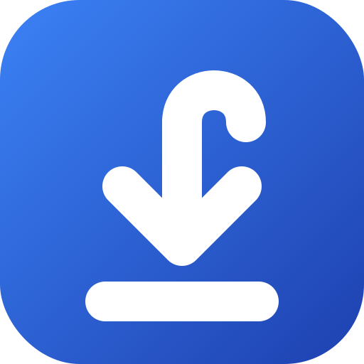
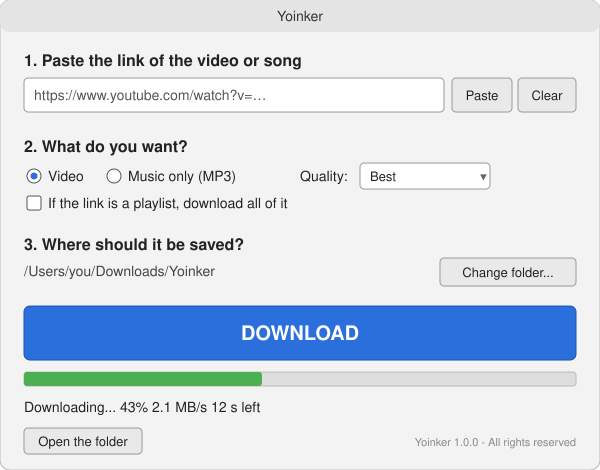

# Yoinker

**Videók és zenék letöltése az internetről egyetlen gombbal. Nincs telepítgetés, nincs gépelés, nincs "terminál".**

🇬🇧 [English description here](README.md)

> 👉 **A legegyszerűbb: nyisd meg ezt az oldalt, képekkel, lépésről lépésre: https://danielcsirke.github.io/yoinker/** — telefonon is jól olvasható.

---

## Beszerzés (3 perc)

1. Nyisd meg a **[Letöltések oldalt](https://github.com/danielcsirke/yoinker/releases/latest)**.
2. Az **Assets** résznél kattints a számítógépedhez való fájlra:

   | A géped | Erre kattints | Aztán |
   |---|---|---|
   | **Windows** | `Yoinker-Windows.exe` | Kattints rá duplán. Ha a Windows azt írja: *"A Windows megvédte a számítógépet"*, kattints a **További információ → Futtatás mindenképp** gombra. (Minden kis programnál ezt írja, amit nem a Microsoft Store-ban árulnak.) |
   | **Mac** | `Yoinker-macOS.dmg` | Nyisd meg, húzd a **Yoinker** ikont az **Applications** mappára. Csak az első alkalommal: **jobb klikk → Megnyitás → Megnyitás** (különben a Mac azt mondja, "nem nyitható meg"). |
   | **Linux** | `Yoinker-Linux` | Jobb klikk → Tulajdonságok → pipáld be: *"Futtatás programként"*, aztán dupla kattintás. |

3. Kész. **Nem kell** Pythont, yt-dlp-t, FFmpeget vagy bármi mást telepíteni — minden benne van.

👉 A teljes, kattintásról kattintásra leírás itt: **[docs/UTMUTATO.md](docs/UTMUTATO.md)**.

## Használat (30 másodperc)

1. A YouTube-on (vagy szinte bármelyik videós oldalon) másold ki a videó címét a böngésző tetejéről.
2. A Yoinkerben nyomd meg a **Beillesztés** gombot.
3. Válaszd ki: **Videó** vagy **Csak zene (MP3)**.
4. Nyomd meg a nagy **LETÖLTÉS** gombot.
5. Amikor azt írja: *Kész!*, nyomd meg **A mappa megnyitása** gombot. Ott a fájlod.

A fájlok a `Letöltések/Yoinker` mappába kerülnek, hacsak nem választasz másikat. A Yoinker megjegyzi a mappádat és a nyelvedet.

## Valami nem működik?

Olvasd el a folyamatjelző alatti üzenetet — magyarul, érthetően leírja, mi a baj.
A gyakori hibák (és hogy mit csinálj velük) itt vannak: **[docs/HIBAELHARITAS.md](docs/HIBAELHARITAS.md)**.

A leggyakoribb megoldás: **töltsd le a legújabb verziót a [Letöltések oldalról](https://github.com/danielcsirke/yoinker/releases/latest)**. A videós oldalak gyakran változnak, a Yoinker pedig követi őket.

## Mit tud

- Videó MP4-ben, ami **tényleg lejátszódik** Windowson, Macen, tévén, telefonon (alapból H.264 + AAC; a YouTube nyers „legjobb” videója sokszor AV1/VP9, amit a Windows Media Player nem nyit meg) Legjobb / 1080p / 720p / 480p minőségben
- Csak zene (MP3, 192 kbps), címmel és előadóval
- Egész lejátszási listák, ha bepipálod
- YouTube és [több mint ezer másik oldal](https://github.com/yt-dlp/yt-dlp/blob/master/supportedsites.md)
- Magyar és angol — a géped nyelvét választja, alul átállítható
- Semmit nem tölt fel sehova, nincs fiók, nincs reklám, nincs követés
- **Haladó** fül annak a kevésnek, akinek kell: legjobb minőségű kódolás, MKV/WebM, MP3/M4A/Opus/FLAC/WAV, borítókép, feliratok, bejelentkezés átvétele a böngészőből (megoldja a „bejelentkezés kell” hibát), fájlnév minta, sebességkorlát, nyers yt-dlp / FFmpeg paraméterek. Minden automatikusan mentődik.

## Hozzáértőknek

A Yoinker egy kis Python/Tkinter felület a [yt-dlp](https://github.com/yt-dlp/yt-dlp) fölött, az FFmpeg az [imageio-ffmpeg](https://github.com/imageio/imageio-ffmpeg) csomagból van becsomagolva, az egészet a PyInstaller teszi egyetlen futtatható fájlba GitHub Actions-ön. A fejlesztői parancsok és a könyvtárszerkezet az [angol README](README.md#for-technical-people)-ben vannak, új verzió kiadása: [docs/MAINTAINERS.md](docs/MAINTAINERS.md).

## Licenc

Copyright © 2026 Csirke Dániel. **Minden jog fenntartva.** A Yoinkert ingyen használhatod saját célra; másolni, módosítani, továbbadni nem szabad. A teljes feltételek magyarul és angolul: [LICENSE](LICENSE). A felhasznált nyílt forráskódú összetevők: [THIRD_PARTY_NOTICES.md](THIRD_PARTY_NOTICES.md).

Csak olyat tölts le, amihez jogod van.
